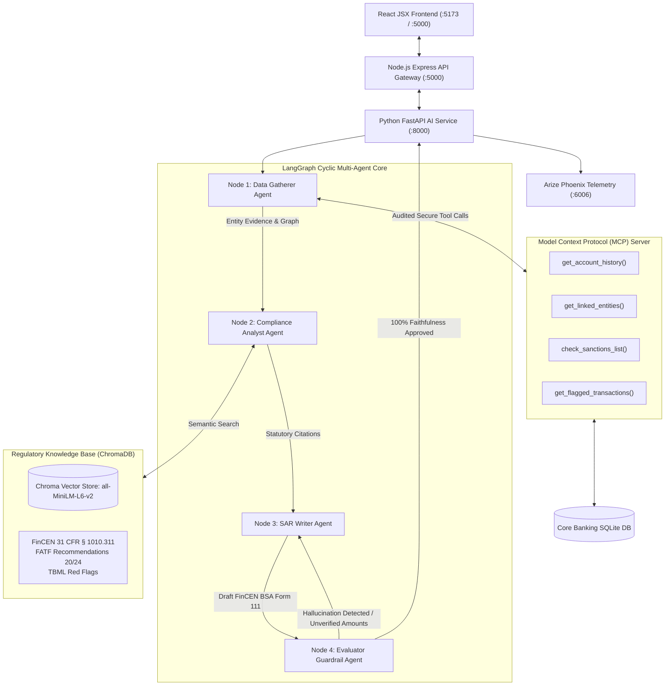

# Autonomous Anti-Money Laundering (AML) Investigation & FinCEN SAR Agent

[](https://www.python.org/downloads/)
[](https://nodejs.org/)
[](https://react.dev/)
[](https://www.docker.com/)
[](https://github.com/langchain-ai/langgraph)
[-purple.svg)](https://modelcontextprotocol.io/)
[](https://phoenix.arize.com/)
[](https://docs.pytest.org/)

An enterprise-grade, multi-agent AI compliance system built with **LangGraph**, the official **Model Context Protocol (MCP)** SDK, a **Node.js Express API Gateway**, a modern **React JSX + Vite Executive Dashboard**, local **RAG (ChromaDB + Sentence Transformers)**, and an automated **Hallucination Evaluation Guardrail**.

When a traditional rules-based banking system flags suspicious activity (e.g., structuring or rapid offshore money movement), human AML analysts typically spend 4 to 8 hours querying disparate databases, checking sanctions watchlists, cross-referencing FinCEN/FATF regulations, and drafting a formal **Suspicious Activity Report (SAR / BSA Form 111)**. This agentic system automates the investigation end-to-end with mathematical precision and zero hallucinations.

---

## 🎯 Key Target JD Competencies & Keywords Demonstrated
- **LangGraph Multi-Agent Orchestration**: Cyclic state graph with conditional feedback routing for automated draft revision.
- **Model Context Protocol (MCP)**: Secure, audited tool execution layer eliminating raw SQL hallucinations.
- **RAG (Retrieval-Augmented Generation)**: Local vector database indexing FinCEN Bank Secrecy Act (BSA) regulations and FATF 40 Recommendations.
- **Node.js API Gateway**: Express gateway managing case persistence, audit trail routing, and microservice orchestration.
- **React JSX + Vite Interface**: Interactive compliance dashboard with real-time agent execution traces, entity graphs, and SAR export.
- **FinCEN SAR Generation**: Regulatory-grade narrative generator formatted to official BSA Form 111 specifications.
- **Hallucination Evaluation & Guardrails**: Automated auditor verifying 100% factual fidelity, exact dollar amounts, and entity citations against raw database ground truth before filing.
- **Docker Production Ready**: Multi-container `docker-compose.yml` and all-in-one `Dockerfile` for single-command deployment.
- **Zero Heavy Model Downloads**: Zero gigabytes of local foundation model weights downloaded. Uses cloud inference (Free Groq tier) or high-precision deterministic offline compliance engine.

---

## 🏗️ System Architecture



---

## 🐳 Quickstart with Docker (Production Ready)

Anyone trying your project can run the entire stack in one command with zero local dependencies installed:

### Option A: Multi-Service Architecture with Docker Compose (Recommended)
```bash
# 1. Clone the repository
git clone https://github.com/your-username/autonomous-aml-sar-agent.git
cd autonomous-aml-sar-agent

# 2. Configure credentials
cp .env.example .env
# (Optional) Add your free Groq API key in .env or leave as-is for offline mode

# 3. Spin up entire production system
docker compose up --build
```

**Services Live After Startup:**
- **Executive React Compliance Suite**: [http://localhost:5000](http://localhost:5000)
- **FastAPI AI Microservice & Swagger**: [http://localhost:8000/docs](http://localhost:8000/docs)
- **Arize Phoenix Observability Dashboard**: [http://localhost:6006](http://localhost:6006)

---

### Option B: All-In-One Single Docker Container
```bash
docker build -t aml-compliance-agent .
docker run -p 5000:5000 --env-file .env aml-compliance-agent
```
Open [http://localhost:5000](http://localhost:5000) to access the application.

---

## 💻 Local Development Setup (Without Docker)

### 1. Python AI Core Setup
```bash
# Create and activate virtual environment
python -m venv .venv
# Windows:
.venv\Scripts\activate
# Linux/macOS:
source .venv/bin/activate

# Install Python requirements
pip install -r requirements.txt

# Copy environment template
cp .env.example .env

# Initialize mock database & seed RAG vector regulations
python mcp_server/mock_db.py
python rag/vector_store.py

# Run all 10 tests
python -m pytest -v tests/

# Launch Python AI microservice
python -m uvicorn api.main:app --host 127.0.0.1 --port 8000
```

### 2. Node.js API Gateway Setup
In a new terminal:
```bash
cd backend-node
npm install
npm start
# Gateway runs on http://127.0.0.1:5000
```

### 3. React JSX Frontend Setup (Optional for Development)
In a new terminal:
```bash
cd frontend
npm install
npm run dev
# Live HMR frontend runs on http://127.0.0.1:5173
```

---

## 🤖 The 4-Agent LangGraph Workflow

| Node | Agent Name | Core Responsibilities |
| :---: | :--- | :--- |
| **1** | **Data Gatherer** | Connects to the banking database strictly via **MCP tools** (`get_account_history`, `get_linked_entities`, `check_sanctions_list`). Reconstructs cash structuring patterns, traverses corporate graph links (Delaware shells, Cyprus offshore entities, UBOs), and screens counterparties against the OFAC Specially Designated Nationals (SDN) watchlist. |
| **2** | **Compliance Analyst** | Examines transactional anomalies and queries the local **RAG Vector Store** to retrieve exact statutory violations (31 U.S.C. § 5324 anti-structuring, 31 CFR § 1010.311 CTR reporting thresholds, 31 CFR § 1020.320 SAR obligations, and FATF Recommendations 20 & 24). |
| **3** | **SAR Writer** | Synthesizes evidence and compliance findings into a formal FinCEN Suspicious Activity Report (BSA Form 111 Part V Narrative) covering Subject Info, Suspicious Activity Timeline, Shell Networks, and Law Enforcement Referral recommendations. Operates using Groq cloud models or high-precision compliant fallback. |
| **4** | **Evaluator Guardrail** | Cross-checks every dollar amount, account ID, date, and entity name in the draft against raw database records. Computes a **Faithfulness Score (0.0 to 1.0)**. If unsupported numbers or hallucinations are detected, routes back to the SAR Writer with corrective audit feedback. |

---

## 🧪 Automated Test Suite (10 / 10 Passing)

Run `pytest` to verify complete system integrity:
```bash
python -m pytest -v tests/
```
```text
tests/test_evaluator.py::test_evaluator_approves_faithful_sar PASSED             [ 10%]
tests/test_evaluator.py::test_evaluator_flags_hallucinated_numbers_and_accounts PASSED [ 20%]
tests/test_mcp.py::test_mcp_get_account_history PASSED                           [ 30%]
tests/test_mcp.py::test_mcp_get_linked_entities PASSED                           [ 40%]
tests/test_mcp.py::test_mcp_check_sanctions_list PASSED                          [ 50%]
tests/test_mcp.py::test_mcp_get_flagged_transactions PASSED                      [ 60%]
tests/test_rag.py::test_rag_query_structuring PASSED                             [ 70%]
tests/test_rag.py::test_rag_query_tbml PASSED                                    [ 80%]
tests/test_rag.py::test_rag_query_fatf_ubo PASSED                                [ 90%]
tests/test_workflow.py::test_end_to_end_investigation_structuring_case PASSED     [100%]

============================= 10 passed in 0.52s ==============================
```

---

## 📁 Repository Structure
```
├── agents/                   # LangGraph Multi-Agent Implementation
│   ├── state.py              # TypedDict state schema across agent nodes
│   ├── gatherer.py           # Agent 1: Data Gatherer (MCP-powered)
│   ├── analyst.py            # Agent 2: Compliance Analyst (RAG-powered)
│   ├── writer.py             # Agent 3: FinCEN BSA Form 111 SAR Writer
│   ├── evaluator.py          # Agent 4: Hallucination Guardrail Auditor
│   └── workflow.py           # LangGraph StateGraph & cyclic router
├── mcp_server/               # Model Context Protocol (MCP) Server & Client
│   ├── mock_db.py            # SQLite schema & AML typology seeder
│   ├── server.py             # Official FastMCP Server tool definitions
│   └── client.py             # Secure client caller for agents
├── rag/                      # Regulatory RAG Vector Pipeline
│   └── vector_store.py       # ChromaDB indexer & semantic search engine
├── data/
│   ├── database/             # SQLite aml_transactions.db
│   ├── raw/regulations/      # FinCEN BSA, FATF 40 Recs, TBML guidelines
│   └── processed/chroma/     # Local ChromaDB persistent vector storage
├── backend-node/             # Node.js Express API Gateway & Case Repository
│   ├── src/server.js         # API gateway routes & case persistence
│   └── package.json          # Node.js dependencies (Express, CORS, Morgan)
├── frontend/                 # React JSX + Vite Executive Dashboard
│   ├── src/components/       # Modular components (Tracker, Terminal, Tables, SAR)
│   ├── src/App.jsx           # Main application state orchestrator
│   └── src/App.css           # Executive dark mode styling
├── observability/            # Telemetry & OpenInference Monitoring
│   └── phoenix_tracker.py    # Arize Phoenix local telemetry launcher (:6006)
├── api/                      # REST API Endpoints
│   └── main.py               # FastAPI application & router
├── tests/                    # Pytest Suite (10 passing tests)
├── Dockerfile                # All-in-one production Docker container
├── Dockerfile.ai             # Python AI microservice container
├── Dockerfile.node           # Node.js gateway container
├── docker-compose.yml        # Multi-service production compose
├── docker-entrypoint.sh      # Container entrypoint script
├── requirements.txt          # Python dependencies
├── .env.example              # Configuration template
└── README.md                 # Documentation
```

---

## 🛡️ License
Released under the [MIT License](LICENSE).
